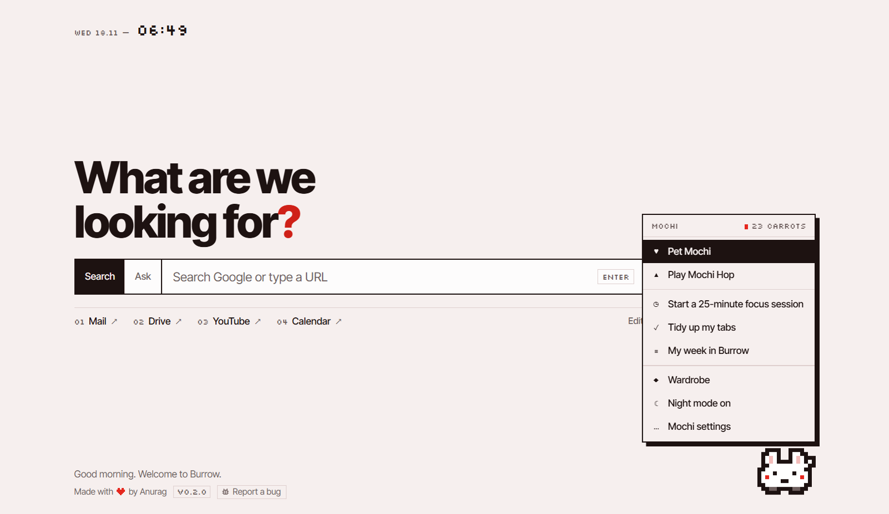
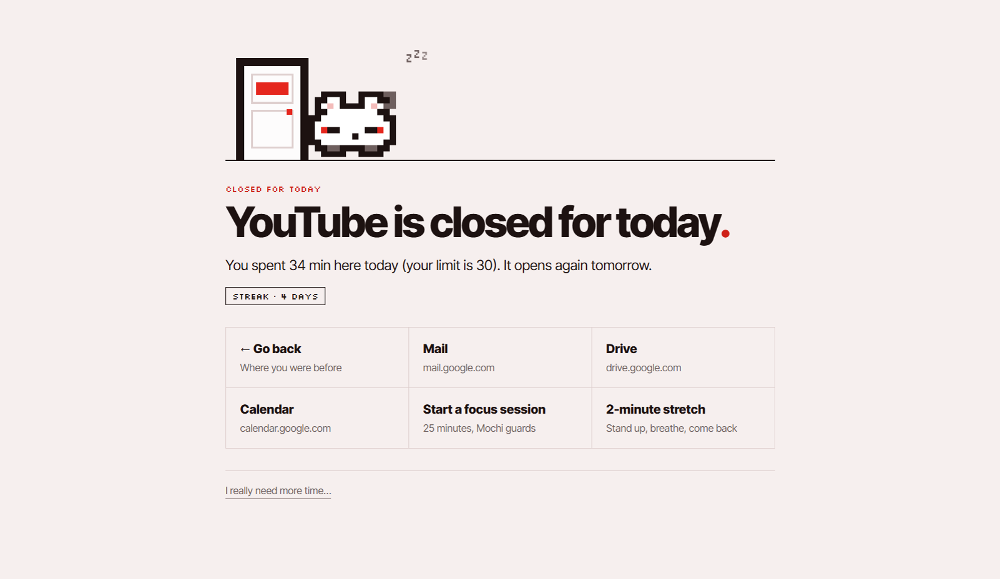
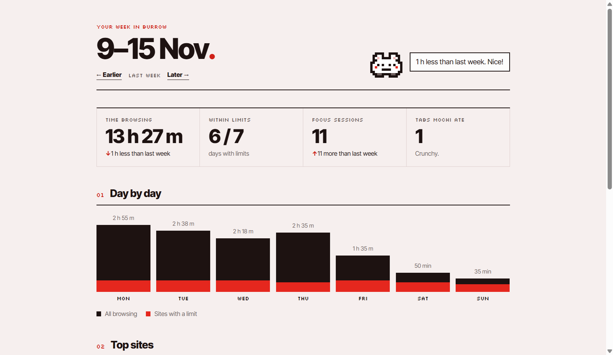
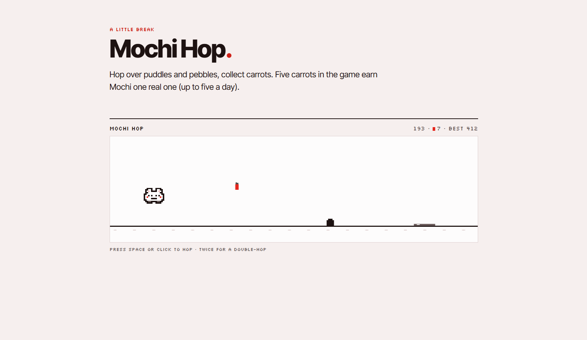
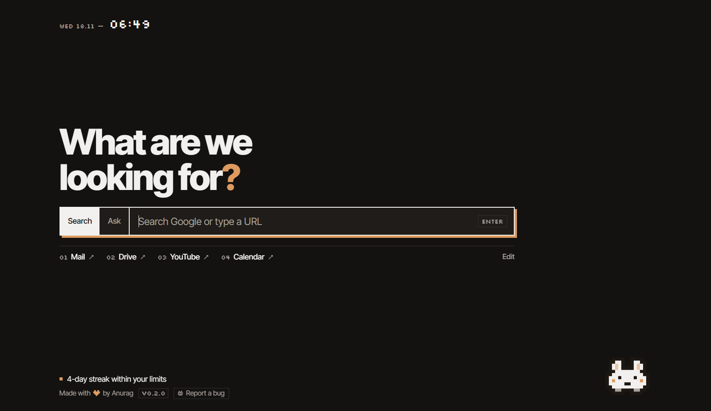
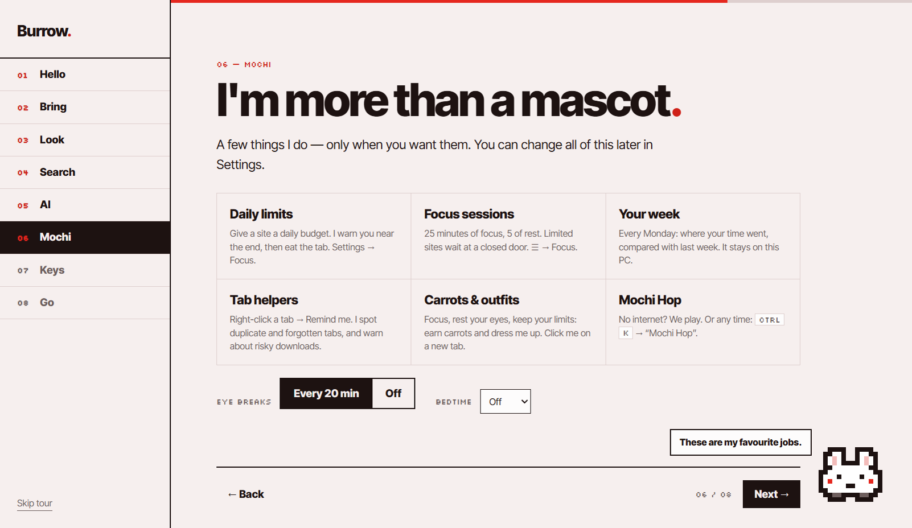

<p align="center">
  
</p>

<h1 align="center">Burrow</h1>

<p align="center">
  A calm, quick desktop browser for Windows — Swiss-grid design with a pixel companion called Mochi.<br>
  Everything a browser should do, plus gentle help with doomscrolling (only if you want it).
</p>

<p align="center">
  <a href="https://github.com/AnuragHarapanahalli/burrow/releases/latest"><b>Download for Windows</b></a> ·
  <a href="#features">Features</a> ·
  <a href="#building-it-yourself">Build it yourself</a> ·
  <a href="https://github.com/AnuragHarapanahalli/burrow/issues/new?labels=bug">Report a bug</a>
</p>

<p align="center">
  
</p>

## Features

**A real browser**
- Numbered tabs, **workspaces** (separate sets of tabs, Ctrl+Shift+1–9), and a tab **sidebar** when you have lots of tabs
- **Split view** (Ctrl+\\): two pages side by side; remembered after a restart
- **Ctrl+K command palette**: tabs, history, bookmarks, actions — or ask your AI
- **Ask AI** from the address bar: questions go to Claude, ChatGPT or Gemini; an **AI side panel** (Ctrl+Shift+A)
- **Reader view** (F9), **notes per website** (Ctrl+Shift+E, export to Markdown), **picture-in-picture**, per-tab **volume up to 200%**
- Right-click menus everywhere, find in page, zoom per site, private windows, drag tabs between windows
- **Tab sleeping** frees memory from tabs you're not using; **import** bookmarks and history from Chrome, Edge, Brave, Vivaldi, Opera or Firefox
- **Site permissions** (camera, microphone, location, notifications), clear browsing data, a NOT SECURE warning before typing passwords on plain-HTTP pages, and risky downloads held until you say Keep

**Help with doomscrolling — when you want it**
- Give a site a **daily time limit**. Mochi warns you near the end, then (after an offer of "1 more minute") **eats the tab**
- Going back shows the **Burrow gate**: calm alternatives, and a breathing-and-typing unlock if you really need more time
- **Focus sessions** (25 min focus, 5 min break) and a **weekly report** of where your time went — kept on your PC only

<p>
  
  
</p>

**Mochi**
- Says helpful things at the right moment (Lively, Quiet or Off), reminds you to rest your eyes, tidies duplicate tabs, brings tabs back when you ask ("Remind me")
- Earns **carrots** for focus and rest — spend them on outfits
- **Mochi Hop**, a little game for when the internet's down (or Ctrl+K → Mochi Hop)
- A **bedtime** wind-down with a warm night mode

<p>
  
  
</p>

<p>
  
</p>

## Installing

Download **Burrow-Setup-x.y.z.exe** from the [latest release](https://github.com/AnuragHarapanahalli/burrow/releases/latest) and run it — it installs for your user in a few seconds, no admin needed. Burrow updates itself after that.

> Burrow isn't code-signed yet, so Windows may say **"Windows protected your PC"** the first time. Click **More info → Run anyway**.

Prefer not to install? **Burrow-x.y.z-portable.exe** runs from anywhere (it doesn't update itself).

Your data stays on your computer: history, bookmarks, notes and the weekly report are plain files in `%APPDATA%\burrow`.

## Building it yourself

You need [Node.js](https://nodejs.org) 20 or newer.

```bash
npm install
npm start          # run Burrow
npm test           # Burrow's self-test (~2 minutes; `npm test -- phase8` for one part)
npm run dist       # make the installer and portable .exe in dist/
```

Releases: `npm version patch` then `git push --follow-tags` — GitHub builds and publishes the new version, and installed copies update themselves.

Plain HTML, CSS and JavaScript on [Electron](https://www.electronjs.org) — no build step. How it all fits together, and why each decision was made, is in [PROJECT_JOURNAL.md](PROJECT_JOURNAL.md).

## Licence

[MIT](LICENSE) — made with ♥ by Anurag.
